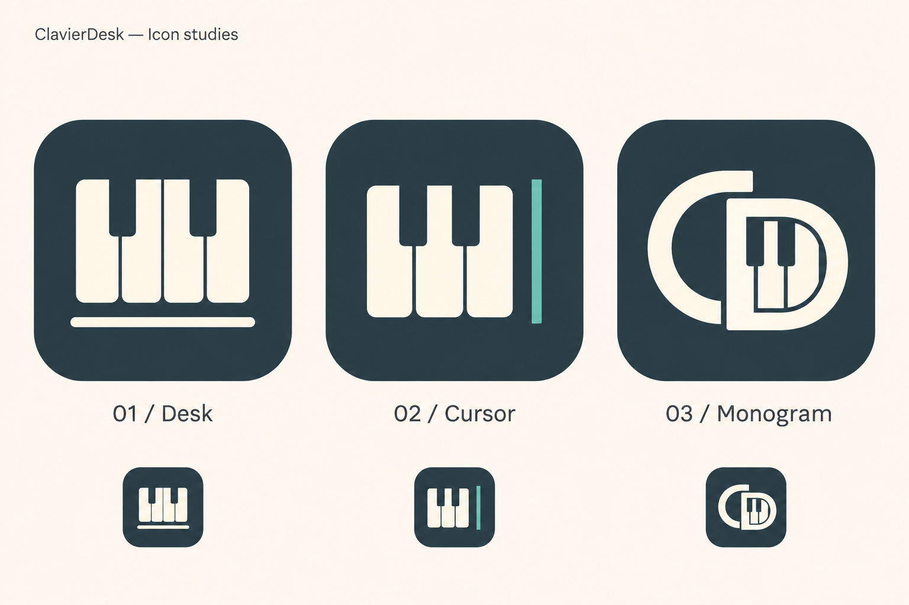

# ClavierDesk：プロダクトの思想と名前の由来

記録日：2026-11-03

アプリ名・アイコンの検討を通して整理した、目指す体験と製品の位置づけを記録する。将来のLP、紹介文、UIや機能の判断に使う。宣伝文句の確定稿ではなく、実装済みの機能を列挙する仕様書でもない。

詳細な譜面モデルと操作仕様は[ドメインモデルと検証方針](../plan/score-domain-model/score-domain-model.md)、構成と開発段階は[移行計画](../plan/score-domain-model/refactoring-plan.md)を参照する。

## 1. 目指すアプリ

ClavierDeskは、ソロピアノの音楽を素早く入力し、聴き、観て、調整できる環境を目指す。

ピアノ譜面を高速で作り、すぐにプレビューできることを重視する。楽譜を成果物として仕上げることに加え、同じ記譜からどのような演奏が生まれるかを試し、ピアノの音楽を研究するためのプラットフォームとして育てる。

中心になる体験は「入力する → 聴く／観る → 調整する」という往復。音符を並べる操作と結果の確認との距離を短くし、思考を止めずに試せる道具にする。

## 2. 出発点となった課題

長年MuseScoreでピアノ譜を作ってきた一方、ソロピアノの大譜表を扱う用途では、必要以上に多い機能や操作が負担になっていた。また、楽譜の直接入力では、小節を音符と休符で正しく埋めるために音価を計算する手間がある。

ピアノロールは音の位置と長さを捉えやすいが、一般的なDTMのマウスでノートを配置・ドラッグする操作にも時間がかかる。そのため、文字を打つような感覚で、キーボードだけでノートを配置・編集できる操作性を求めた。

Scorehackのアウトライン／タイムライン、キー入力、単位管理、自動スクロールを出発点にした。ただし、歌メロと伴奏やコード進行を中心とするモデルをそのまま使わず、上下段・和音・複数声部・指番号を扱うピアノ譜のためのモデルを作る。

## 3. 体験の柱

### キーボードだけで、素早く扱える

マウスを使わずに入力・移動・選択・編集を完結できることを重視する。キーボード操作は補助機能ではなく、製品の中心的な特徴である。

ただし、文字を打つように操作できることと、テキストやプログラムを書く入力形式であることは別。実際の編集対象はピアノロール上のノートである。

### ピアノロールで編集し、内部は楽譜として成立する

小節・段・声部・音符／休符・記譜音価・タイなど、楽譜の構造を土台にする。休符の補完や整合処理をアプリが引き受け、扱いやすい操作とデータの正しさを両立する。

MusicXMLとの互換性は、独自の都合だけで音楽データを作らないための重要な基準。専用形式ではアプリ固有の演奏情報や編集状態も保存し、MusicXMLで表現できる範囲との区別を明確にする。

### 同じ記譜でも、演奏の違いを作り込める

記譜上の表現と、どのように演奏するかの情報を区別して扱う。操作上は同じ設定画面で扱えてもよい。

スタッカートの長さ、アルペジオの速度や発音位置、トリルの発音数などを細かく調整し、将来はノートごとのベロシティも扱う。記譜を確認するための音出しにとどめず、ある程度聴ける音源を作れることを目標とする。

### 音色と演奏の見え方も試せる

外部SoundFont（sf2）を設定できるようにし、音色をカスタマイズする余地を持たせる。

将来的には指番号と連動した3Dモデルの演奏プレビューにつなぎ、演奏を観察すると同時に、観て楽しめる環境にする。

## 4. 今後の構想と、現在との区別

この資料を記録した時点では、Svelteの検証アプリで譜面モデルと編集操作、楽譜プレビューの基盤を作り、保守向けの責務分離を進めた段階。以下の目標がすべて実装されているわけではない。

| 項目 | 位置づけ |
|---|---|
| キーボード中心の編集と記譜構造 | 現在の基盤。引き続き使いやすさを磨く |
| 記譜上の表現と演奏設定 | 一部の設定・計算を実装済み。スタッカートとスラーはプレビュー再生にも反映 |
| Tauriアプリ | 現行editorを移行済み。Windows上の起動・編集を確認 |
| 外部SoundFont、起動時の読み込み | 外部SF2を同梱し、起動時に読み込む |
| プレビュー再生と音源としての作り込み | Spaceで現在位置から再生・停止。通常音符、和音、タイ、テンポ、スラー、スタッカート、トリル、ペダル、アルペジオに対応。個別ベロシティ等は今後 |
| 指番号と連動した3D演奏プレビュー | 別の3d-motion-labでの研究を将来つなげる |
| MCP | 実装する方針は確定。エージェントから譜面を扱う接続基盤を作る |
| エージェントによる作曲や、楽譜PDFを読んでの入力 | MCP活用の構想。方式・精度・対応範囲は未確定 |
| MusicXMLのファイル入出力、専用形式での完全復元 | データ設計上の方針。完成したファイル入出力機能と混同しない |

音色・3D・MCPを追加しても、素早く入力し結果を確かめられる体験を土台にする。将来機能をLPに載せる際は、提供中の機能と構想を区別する。

## 5. 名前：ClavierDesk

正式な表記は **ClavierDesk**。

「Clavier」は鍵盤楽器を表す言葉。「Desk」は机・作業環境を表す。この組み合わせを、ピアノの音楽を考え、入力し、聴いて調整するための、自分の作業机という意味で採用した。

名称は物理的な机を再現するUIや、デスクトップ版だけに限定するという要件を意味しない。ピアノを扱う日常的な道具・環境としての比喩である。

### 採用までの判断

- Scribe・Script・Folioなど、「書く」「譜面や作品を作る」方向から検討を始めた。
- 作りたいものは楽譜という成果物だけでなく、ピアノの音楽を試し、研究する環境だと整理した。
- Labはその用途に合うが、研究環境を直球で説明しすぎると感じた。
- Prismは複数の角度から音楽を探る意味を持たせられるが、少し誇張した印象があった。
- Canvasの創造性と体験を含む方向に共感し、身近な道具・場所の言葉へ検討を広げた。
- Deskの控えめで日常的な作業環境という印象が、長く使う道具としての目標に合った。

既存製品との比較検討を経ているが、名称の商標・利用可能性を正式に確認したという記録ではない。

## 6. 製品としての佇まい

命名時のユーザーの意向：

> あまりマーケ感・キラキラ感を出さず、洗練した道具として長く使っていけるものを目指したいです。

UI、紹介文、アイコンもこの意向を基準にする。落ち着きと実用性があり、繰り返し使って邪魔にならないことを重視する。

LPで価値を説明する際も、能力を大きく語るより、何をどう操作でき、どのような結果を確かめられるかを具体的に伝える。音楽研究のプラットフォームという位置づけは、万能な作曲環境や自動演奏の完全な再現を保証する表現にはしない。

## 7. アイコンの採用方針

比較した3案は、鍵盤と作業面、鍵盤と入力カーソル、CDのモノグラム。

採用したのは **02 / Cursor：鍵盤と入力カーソル**。

Desk案のバランスも好ましかったが、キーボード入力をアプリの独自性として示したいため、入力カーソル案を選んだ。鍵盤でピアノとの関係を、カーソルで入力する道具としての性格を表す。

比較画像は下記に保存する。中央の案が採用方向であり、他の2案は比較用。生成画像はコンセプト資料であり、最終的なアプリアイコンのサイズ別データやSVGとして完成したものではない。

比較案で用いた暗い青灰色、柔らかな明色の鍵盤、控えめな青緑のカーソルを方向性とする。色値・形状・角丸・小サイズでの調整は、実際のアイコン制作時に確定する。

## 8. 紹介文を作る際の素材

以下は思想を短く言い換えた作業用の文章。正式なコピーとして採用したものではない。

- ピアノの音楽を、入力し、聴き、観て、調整するための作業環境。
- キーボードで素早く譜面を作り、演奏の表情まで試せるピアノエディター。
- 楽譜の構造を土台に、音色・演奏表現・運指を探るための道具。

紹介の中心に置くのは、ソロピアノへの特化、キーボードだけで扱える操作性、楽譜としての整合、入力とプレビューの往復。提供状況を説明する際は、その時点の実装を別途確認する。

Tauri化MVPでは、この採用方向を[SVGマスター](../../code/apps/editor/public/icon.svg)として実装し、アプリアイコンを生成した。実装・確認結果は[Tauri化MVP](../plan/score-domain-model/tauri-mvp.md)を参照する。
